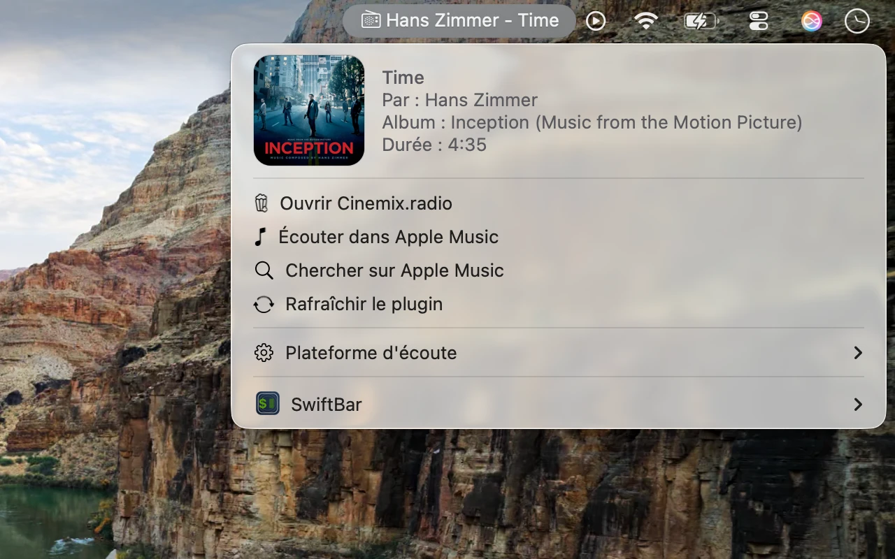

# Cinemix Now Playing

Un plugin [SwiftBar](https://swiftbar.app) qui affiche dans la barre de menus macOS ce qui passe sur [Cinemix](https://www.cinemix.radio/), la radio de bandes originales de films.

[English version](README.md)



> Plugin non officiel, sans lien avec Cinemix. Il lit la page publique
> `https://cinemix.us/SAM/playing.php`, dont la structure peut changer sans préavis.
> Fourni tel quel.

## Fonctionnalités

- Morceau en cours dans la barre de menus, avec une icône de radio.
- Menu avec la jaquette (coins arrondis), le titre, l'artiste, l'album et la durée.
- Prochain album annoncé.
- Raccourcis : ouvrir Cinemix.radio, écouter la station dans Apple Music, chercher le morceau en cours sur ta plateforme.
- Réglage de la plateforme : Apple Music, Spotify, Deezer, Qobuz ou YouTube Music (menu « Plateforme d'écoute »).
- Modes clair et sombre.

## Prérequis

- macOS et SwiftBar.
- Python 3.7 ou plus (celui d'Xcode / des Command Line Tools convient). Aucun paquet à installer.
- Facultatif : `swiftc` (Xcode ou Command Line Tools) pour la jaquette arrondie et l'icône de la barre de menus. Sans lui, le plugin retombe sur un affichage plus simple.

## Installation

1. Installer SwiftBar : `brew install --cask swiftbar`, ou le télécharger sur [swiftbar.app](https://swiftbar.app).
2. Lancer SwiftBar et choisir un dossier de plugins.
3. Copier `cinemix.30s.py` dans ce dossier et le rendre exécutable :

   ```bash
   chmod +x cinemix.30s.py
   ```

4. Dans SwiftBar, cliquer sur « Refresh All ». Le `30s` du nom de fichier signifie que le plugin se rafraîchit toutes les 30 secondes.

## Plateforme d'écoute

Ouvre le sous-menu « Plateforme d'écoute » et choisis ta plateforme. Le choix est mémorisé.

| Plateforme | « Écouter » | « Chercher » |
|---|---|---|
| Apple Music | Ouvre la station Cinemix dans Musique | Cherche « Artiste - Titre » |
| Spotify, Deezer, Qobuz, YouTube Music | Non affiché (pas de station Cinemix) | Cherche « Artiste - Titre » |

## Personnalisation

Les constantes en haut de `cinemix.30s.py` règlent l'apparence : taille de la jaquette, couleurs du texte, largeur de la ligne « à suivre », taille et position de l'icône de la barre de menus, liste des plateformes.

## Fichiers créés

- `~/.config/cinemix/` : plateforme choisie et un petit outil Swift (`cinemix-card`) compilé au premier lancement. Il dessine la jaquette arrondie et l'icône de la barre de menus. Son code source est la constante `CARD_SWIFT` du plugin.
- Ton dossier temporaire : de petites images en cache (`cinemix-*.png`), supprimées au bout de 24 heures.

Pour tout supprimer, retire le plugin et le dossier `~/.config/cinemix/`.

## Dépannage

- **« Permission denied »** : relance `chmod +x` sur le plugin. Remplacer le fichier fait perdre le droit d'exécution.
- **« You have not agreed to the Xcode license agreements »** : après une mise à jour d'Xcode, lance `sudo xcodebuild -license accept` dans un terminal.
- **Affichage simple au lieu de la jaquette arrondie** : l'outil Swift est encore en cours de compilation (quelques secondes) ou `swiftc` est absent. Rafraîchis de nouveau après une minute.
- **« morceau introuvable dans la page »** : la page de Cinemix a changé ou n'est pas joignable. Vérifie [cinemix.us/SAM/playing.php](https://cinemix.us/SAM/playing.php).

## Licence

[MIT](LICENSE)
